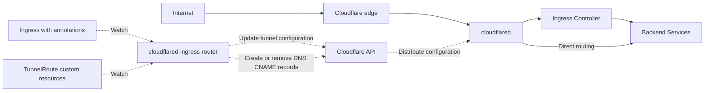

# cloudflared-ingress-router

A Kubernetes custom controller that automatically manages Cloudflare Tunnel (cloudflared) configuration and DNS records using Ingress annotations and TunnelRoute custom resources.

HTTP / HTTPS routing is typically handled by an existing Ingress Controller, such as Traefik, nginx-ingress, Envoy, or HAProxy. By default, cloudflared forwards each hostname to the Traefik Service. You can override this with the `--origin-url-https` / `--origin-url-http` flags or the `origin-service` annotation to **use another Ingress Controller or route directly to a Service**.



## How it works

- Collects public hostnames from `spec.rules[].host` on Ingress resources annotated with `cloudflared-ingress-router.windyakin.net/enabled: "true"`, and from `spec.rules[].hostname` on TunnelRoute custom resources.
- Combines all eligible Ingress and TunnelRoute resources into a single tunnel configuration, including ingress rules and a final `http_status:404` catch-all rule, and sends it to the [Tunnel configurations API](https://developers.cloudflare.com/api/resources/zero_trust/subresources/tunnels/subresources/cloudflared/subresources/configurations/) with a PUT request. This requires a remotely-managed tunnel. **Changes take effect without restarting cloudflared.**
- Creates a proxied CNAME record for each hostname, pointing `<hostname>` to `<tunnel-id>.cfargotunnel.com`.
- Uses finalizers to remove DNS records and tunnel configuration entries when resources are deleted or an Ingress opts out. DNS ownership is tracked through a management marker in the record's comment field, so records created manually or by other tools, such as external-dns, are left untouched.

## Prerequisites

- A **remotely-managed** tunnel. Start cloudflared with `cloudflared tunnel run --token <TOKEN>`.
  - If you currently use a locally-managed tunnel (`config.yaml` + `credentials.json`), migrate its configuration to remote management through the dashboard or API, and update the Deployment to use token-based startup.
  - `cloudflared tunnel run` does not hot-reload configuration files, so mounting a ConfigMap cannot apply configuration changes dynamically. This is why the controller uses the API.
- **The tunnel must be dedicated to this controller.** The configurations API replaces the entire configuration. Manual Public Hostname settings added through the dashboard or other tools are overwritten during periodic reconciliation (every 10 minutes by default).
- A Cloudflare API token with the following permissions:
  - Account > Cloudflare Tunnel > Edit
  - Zone > DNS > Edit
  - Zone > Zone > Read

## Installation

### Helm (recommended)

```sh
helm repo add cloudflared-ingress-router https://windyakin.github.io/cloudflared-ingress-router
helm repo update

helm install cloudflared-ingress-router cloudflared-ingress-router/cloudflared-ingress-router \
  --namespace cloudflared-ingress-router --create-namespace \
  --set cloudflare.accountId=<CLOUDFLARE_ACCOUNT_ID> \
  --set cloudflare.tunnelId=<TUNNEL_ID> \
  --set cloudflare.apiToken=<API_TOKEN>
```

To use an existing Secret, set `cloudflare.existingSecret`. The Secret must contain the keys `accountId`, `tunnelId`, and `apiToken`.

```sh
helm install cloudflared-ingress-router cloudflared-ingress-router/cloudflared-ingress-router \
  --namespace cloudflared-ingress-router --create-namespace \
  --set cloudflare.existingSecret=my-cloudflare-secret
```

Key values:

| Parameter | Default | Description |
|---|---|---|
| `cloudflare.accountId` | (required) | Cloudflare account ID |
| `cloudflare.tunnelId` | (required) | ID of the tunnel to manage |
| `cloudflare.apiToken` | (required) | Cloudflare API token |
| `cloudflare.existingSecret` | `""` | Existing Secret name; replaces the three values above |
| `controller.originUrlHttps` | `https://traefik.kube-system.svc.cluster.local:443` | Default origin for HTTPS |
| `controller.originUrlHttp` | `http://traefik.kube-system.svc.cluster.local:80` | Default origin for HTTP |
| `controller.resyncInterval` | `10m` | Periodic reconciliation interval |
| `controller.leaderElect` | `true` | Enable leader election |

See [`values.yaml`](charts/cloudflared-ingress-router/values.yaml) for all parameters.

### Kustomize

```sh
# Create the Secret
kubectl create namespace cloudflared-ingress-router
kubectl -n cloudflared-ingress-router create secret generic cloudflared-ingress-router \
  --from-literal=accountId=<CLOUDFLARE_ACCOUNT_ID> \
  --from-literal=tunnelId=<TUNNEL_ID> \
  --from-literal=apiToken=<API_TOKEN>

# Apply the manifests (adjust origin URLs and other settings in config/deployment.yaml)
kubectl apply -k config/
```

## Usage

### Using Ingress

Add an annotation to an Ingress resource while keeping routing handled by your existing Ingress Controller.

```yaml
apiVersion: networking.k8s.io/v1
kind: Ingress
metadata:
  name: myapp
  annotations:
    cloudflared-ingress-router.windyakin.net/enabled: "true"
spec:
  ingressClassName: traefik  # nginx, envoy, etc. also work
  rules:
    - host: myapp.example.com
      http:
        paths:
          - path: /
            pathType: Prefix
            backend:
              service:
                name: myapp
                port:
                  number: 80
```

The controller creates a CNAME record for `myapp.example.com` and exposes it through the tunnel: cloudflared → Ingress Controller → myapp.

To route directly to a Service, set a custom origin URL with the `origin-service` annotation.

```yaml
annotations:
  cloudflared-ingress-router.windyakin.net/enabled: "true"
  cloudflared-ingress-router.windyakin.net/origin-service: "http://myapp.default.svc.cluster.local:8080"
```

### Using TunnelRoute (custom resource)

Use a `TunnelRoute` custom resource to define routing rules without creating an Ingress resource. This is useful for routing directly to Services or specifying backends that are difficult to express in an Ingress spec.

```yaml
apiVersion: cloudflared-ingress-router.windyakin.net/v1alpha1
kind: TunnelRoute
metadata:
  name: monitoring
  namespace: monitoring
spec:
  rules:
    - hostname: grafana.example.com
      service: http://grafana.monitoring.svc.cluster.local:3000
    - hostname: prometheus.example.com
      service: http://prometheus.monitoring.svc.cluster.local:9090
      originRequest:
        httpHostHeader: prometheus.internal
```

TunnelRoute resources are **enabled as soon as they are created**; no `enabled` annotation is needed. Deleting a TunnelRoute automatically removes its DNS records and tunnel configuration entries.

A single TunnelRoute can define multiple rules. Use `originRequest` to configure connection settings for each rule.

#### TunnelRoute spec reference

| Field | Type | Description |
|---|---|---|
| `spec.rules` * | `[]object` | List of routing rules |
| `spec.rules[].hostname` * | `string` | Public hostname, e.g. `app.example.com` or `*.example.com` |
| `spec.rules[].service` * | `string` | Origin URL, e.g. `http://myapp.default.svc:8080`, `https://myapp.default.svc:443`, or `http_status:404` |
| `spec.rules[].originRequest` | `object` | Connection settings; uses cloudflared defaults when omitted |
| `spec.rules[].originRequest.noTLSVerify` | `bool` | Disable origin certificate verification |
| `spec.rules[].originRequest.originServerName` | `string` | TLS SNI and certificate verification name for the origin |
| `spec.rules[].originRequest.httpHostHeader` | `string` | Override the Host header sent to the origin |
| `spec.rules[].originRequest.http2Origin` | `bool` | Connect to the origin using HTTP/2 |
| `spec.rules[].originRequest.caPool` | `string` | Path to the CA bundle for origin verification inside the cloudflared container |

\* Required field.

### Hostname conflict resolution

If multiple resources (Ingress or TunnelRoute) expose the same hostname, the first resource in lexicographical `Kind/Namespace/Name` order wins. Other resources receive a Warning Event with the reason `HostnameConflict`. Since `"Ingress"` sorts before `"TunnelRoute"`, Ingress resources take precedence over TunnelRoute resources.

### Ingress annotation reference

Prefix: `cloudflared-ingress-router.windyakin.net/` (configurable with `--annotation-prefix`).

| Annotation | Default | Description |
|---|---|---|
| `enabled` | - | Set to `"true"` to expose the Ingress (opt-in) |
| `origin-scheme` | `https` | Connection scheme from cloudflared to the origin: `http` or `https` |
| `origin-service` | Controller's default origin URL | Override the origin entirely, e.g. `http://myapp.default.svc.cluster.local:8080` to bypass the Ingress Controller |
| `no-tls-verify` | `false` | Disable origin certificate verification |
| `origin-server-name` | The hostname itself | TLS SNI and certificate verification name for the origin. Defaults to the public hostname, allowing certificate verification for origins that select certificates using SNI, such as Traefik |
| `http-host-header` | (unset) | Override the Host header sent to the origin |
| `http2-origin` | `false` | Connect to the origin using HTTP/2 |
| `ca-pool` | (unset) | **Path inside the cloudflared container** to the CA bundle for origin verification. Mount the certificates into the cloudflared Pod using a Secret or another volume source |

- Public hostnames come from `spec.rules[].host`, sharing the Ingress Controller's routing definition.
- Wildcard hostnames (`*.example.com`) are supported, but do not receive a default `origin-server-name`. For HTTPS origins, explicitly set `origin-server-name` or use `no-tls-verify: "true"`.

## Controller flags

| Flag | Default | Description |
|---|---|---|
| `--account-id` | (required) | Cloudflare account ID |
| `--tunnel-id` | (required) | ID of the tunnel to manage |
| `--annotation-prefix` | `cloudflared-ingress-router.windyakin.net` | Domain portion of the annotation prefix |
| `--origin-url-https` | `https://traefik.kube-system.svc.cluster.local:443` | Default origin for `origin-scheme: https`; adjust this for your Ingress Controller |
| `--origin-url-http` | `http://traefik.kube-system.svc.cluster.local:80` | Default origin for `origin-scheme: http`; adjust this for your Ingress Controller |
| `--resync-interval` | `10m` | Periodic reconciliation interval for correcting drift |
| `--leader-elect` | `false` | Enable leader election |

Pass the API token through the `CLOUDFLARE_API_TOKEN` environment variable.

## Known limitations

- Immediately after scaling up cloudflared, new replicas may return 503 responses for a few seconds until they receive the configuration ([cloudflared#1171](https://github.com/cloudflare/cloudflared/issues/1171)).
- The zone list is cached when the controller starts. Restart the controller after adding zones to your Cloudflare account.
- Each tunnel supports up to 100 cloudflared connections (25 replicas).

## Development

```sh
make test          # Run Go tests
make build         # Build bin/cloudflared-ingress-router
make docker-build  # Build the container image
```
